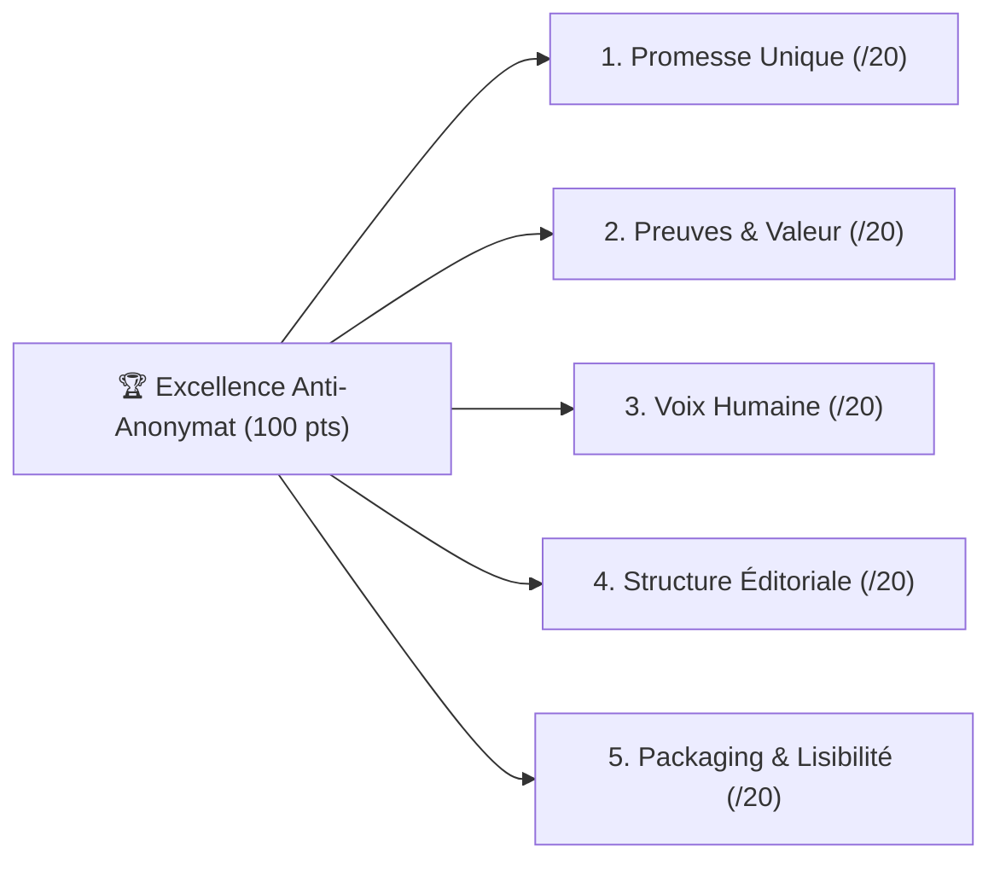

# 🛡️ SKILL : SUPERVISEUR DE CONFORMITÉ AMAZON KDP & ANTI-ANONYMAT (AGENT 4)

Ce skill régit l'agent superviseur bloquant (**Quality Gate**) qui inspecte chaque ouvrage avant son exportation définitive sur deux axes fondamentaux :
1. **Conformité Juridique & Politiques Strictes Amazon KDP** (tolérance zéro sur les violations de TOS).
2. **Audit d'Excellence Commerciale & Anti-Anonymat** (interdiction formelle des livres génériques, pauvres ou ordinaires).

---

## 📋 1. Checklist Juridique & Politiques Amazon KDP (Infractions Bloquantes)

Toute non-conformité sur cette checklist entraîne un verdict **`REJECTED_FOR_REVISION`** et le **blocage strict de l'archive ZIP**.

### 1.1. Anti Keyword-Stuffing (Nom d'Auteur)
- **Règle KDP :** Le champ auteur ne doit contenir **que** le nom de plume ou le nom légal de l'auteur. Aucun mot-clé de recherche, titre ou descripteur de catégorie n'est toléré.
- ❌ **Interdit :** `Coloring Books For Kids Publisher`, `Best Planners Press`, `Livre De Coloriage Mignon`, `Activity Book Studio`.
- ✅ **Autorisé :** Un nom humain crédible (ex: `Jean Dupont`, `Marc Évrard`, `MarkEddy`) ou une maison d'édition déclarée (ex: `Éditions MarkEddy`).

### 1.2. Limite Stricte de 200 Caractères (Titre + Sous-Titre)
- **Règle KDP :** Le titre principal combiné au sous-titre ne doit **jamais dépasser 200 caractères**.
- Au-delà, Amazon KDP tronque le titre sur mobile ou rejette purement et simplement le fichier lors de la validation prépresse.

### 1.3. Proscription Absolue des Allégations Trompeuses & Tarifs
- **Règle KDP :** Sont strictement interdits dans le titre, le sous-titre et la couverture :
  - Allégations de classement : `bestseller`, `best-seller`, `#1`, `n°1`, `numéro 1`, `premier du marché`.
  - Mentions tarifaires ou promotionnelles : `gratuit`, `free`, `promo`, `promotion`, `pas cher`, `prix cassé`, `solde`, `illimité`.

### 1.4. Protection Propriété Intellectuelle & Marques Notoires
- **Règle KDP :** L'usage sans licence officielle de marques déposées ou d'univers protégés est un motif de suspension immédiate de compte KDP :
  - ❌ *Disney, Marvel, Pokémon, Lego, Minecraft, Star Wars, Harry Potter, Fortnite, Barbie, Nintendo, PlayStation, Xbox*...

### 1.5. Disclaimers Obligatoires par Niche Réglementée
- Pour les niches sensibles, un avertissement légal clair de non-responsabilité est **obligatoire** :
  - **Finances / Argent / Investissement :** Avertissement sur les risques financiers et l'absence de conseil en investissement personnalisé.
  - **Santé / Bien-être / Médical :** Avertissement médical invitant à consulter un professionnel de santé agréé.
  - **Enfants / Éducation :** Mentions de surveillance parentale et respect des normes d'âge.

### 1.6. Déclaration de Transparence IA KDP
- Conformément aux directives Amazon KDP, toute génération ou assistance par intelligence artificielle (textes, images ou traduction) doit faire l'objet d'une déclaration transparente dans le portail KDP.

### 1.7. Minimum 24 Pages pour le Livre Broché (Paperback)
- **Règle KDP :** Amazon exige au minimum **24 pages** pour une reliure brochée. Si le manuscrit compte moins de 24 pages, l'orchestrateur doit injecter des pages bonus utiles (carnet de notes, plan d'action, diplôme).

### 1.8. Interdiction de Texte sur la Tranche (Dos) si < 79 Pages
- **Règle KDP :** Pour les livres de moins de **79 pages**, l'épaisseur de la tranche est trop faible pour garantir la précision d'impression. Le texte sur le dos est **strictement proscrit**.

### 1.9. Réserve Normalisée Code-Barres ISBN
- La 4ème de couverture (back cover) doit obligatoirement préserver un rectangle blanc de **600 × 360 px** à 300 DPI en bas à droite, entièrement exempt de texte ou de visuel.

---

## 🏆 2. Grille d'Excellence Anti-Anonymat (Score sur 100 Points)

Pour empêcher la publication d'ouvrages ordinaires, le superviseur attribue une note sur 100 décomposée en 5 piliers d'autorité de 20 points chacun. **Le seuil minimal d'approbation est de 85 / 100.**

### 1. Promesse Unique & Clarté du Titre (/20)
* Titre mémorable, court et percutant (2 à 5 mots).
* Sous-titre orienté bénéfice mesurable et transformation concrète.
* Niche ciblée avec positionnement différenciant sans généricité.

### 2. Preuves, Rigueur & Valeur Concrète (/20)
* Études de cas chiffrées, exemples vécus et données terrain.
* Démarche étape par étape sans digression creuse (Anti-Fluff).
* Disclaimers légaux précis et adaptés à la niche.

### 3. Voix Humaine & Anti-Tics IA (/20)
* Nom d'auteur crédible avec présentation d'autorité (bio d'auteur).
* Style fluide avec variation naturelle de longueur de phrase.
* Élimination totale des clichés robotiques (*Dans ce chapitre nous allons...*, *Il est important de noter que...*).

### 4. Structure Éditoriale de Prestige (/20)
* Front-Matter complet : Page de faux-titre, page de titre, mentions de copyright complètes.
* Table des matières détaillée avec pagination.
* Back-Matter professionnel : Achevé d'imprimer, dépôt légal, colophon et invitation au passage à l'action.

### 5. Packaging Prépresse & Lisibilité (/20)
* Couverture complète 300 DPI avec dos calculé au micron.
* Réserve ISBN 600×360 px respectée.
* Marge de reliure (gutter) asymétrique conforme (>= 0.85" côté dos) évitant l'effet de reliure avalée.

---

## ⚖️ 3. Matrice de Verdict de la Porte Qualité

| Score d'Excellence | Infractions Bloquantes | Verdict | Action Orchestrateur |
| :--- | :--- | :--- | :--- |
| **$\ge$ 85 / 100** | **0** | **`APPROVED_FOR_KDP`** | ✅ Export ZIP autorisé, certification KDP intégrée au manifeste. |
| **< 85 / 100** | **0** | **`REJECTED_FOR_REVISION`** | ⛔ **Export bloqué** : Ouvrage jugé trop générique ou incomplet. Recommandations émises. |
| **Quelconque** | **$\ge$ 1** | **`REJECTED_FOR_REVISION`** | ⛔ **Export bloqué** : Infraction KDP critique détectée. Remédiation obligatoire. |
