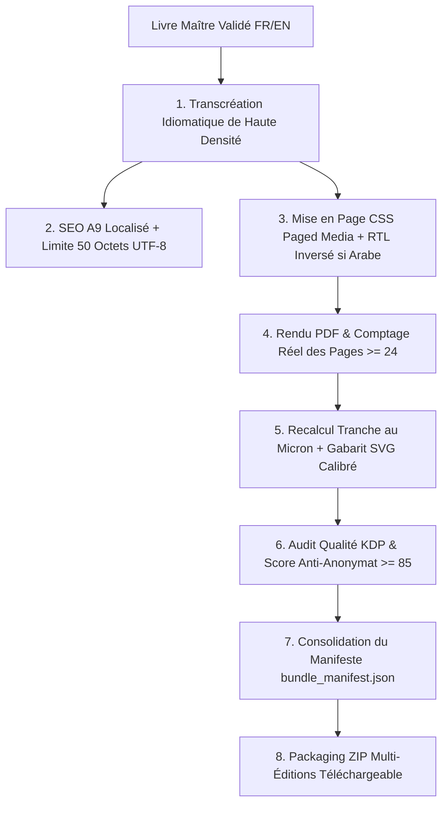

# 🌍 SKILL : TRANSCRÉATION MULTILINGUE IDIOMATIQUE & BUNDLE KDP (AGENT 6)

Ce skill régit la production automatisée et indépendante des éditions internationales d'un livre d'excellence MarkEddy KDP pour les 5 langues majeures : **Anglais (`en`), Français (`fr`), Espagnol (`es`), Allemand (`de`) et Arabe (`ar`, avec support RTL complet)**.

---

## 1. Règle Fondamentale : Transcréation vs Traduction Littérale

> [!IMPORTANT]
> **Interdiction absolue de traduction mot-à-mot (zéro traduction littérale mécanique).**
> Chaque édition cible est un produit éditorial indépendant, entièrement transcréé pour résonner avec les réalités économiques, réglementaires, culturelles et psychologiques des lecteurs de la marketplace visée.

### Matrice d'Adaptation Culturelle & Financière par Marché :

| Langue | Marketplace | Devise | Concepts & Réalités Spécifiques | Pairing Typographique |
| :--- | :--- | :--- | :--- | :--- |
| **Anglais (`en`)** | `amazon.com` / `amazon.co.uk` | `$` / `£` | 401(k), Roth IRA, S&P 500, High-Yield Savings Account (HYSA), Credit Score FICO | Inter / Merriweather, Cinzel / Garamond |
| **Français (`fr`)** | `amazon.fr` / `amazon.ca` | `€` / `$` | PEA, Assurance-Vie, Livret A, SCPI, Intérêts composés, Fiscalité des plus-values | Cinzel / Garamond, Playfair Display / Cormorant |
| **Espagnol (`es`)** | `amazon.es` / `amazon.com` | `€` / `$` | Fondos Indexados, Planes de Pensiones, Cuenta Remunerada, Letras del Tesoro, IRPF | Montserrat / Lora, Cinzel / EB Garamond |
| **Allemand (`de`)** | `amazon.de` | `€` | ETF-Sparplan, Tagesgeld, Festgeld, Notgroschen, Drei-Säulen-Modell, Riester | Fira Sans / Merriweather, Inter / Lora |
| **Arabe (`ar`)** | `amazon.ae` / `amazon.sa` / Kindle | `د.إ` / `ر.س` / `$` | الاستثمار الحلال (Halal Investing), الصكوك (Sukuk), المرابحة (Murabaha), التضخم والأصول الحقيقية | Cairo / Amiri / Tajawal (100 % Arabe natif) |

---

## 2. Spécifications Techniques RTL & Typographie Arabe

Pour la langue Arabe (`ar`) :
1. **Direction du document :** Déclaration obligatoire `<html lang="ar" dir="rtl">`.
2. **Alignement du texte :** `text-align: right;` par défaut, chiffres orientés et lisibles.
3. **Inversion stricte de la reliure (Gutter) :**
   - Sur les pages impaires (recto) : marge de reliure positionnée à **DROITE** (`margin-right: 0.75in; margin-left: 0.45in;`).
   - Sur les pages paires (verso) : marge de reliure positionnée à **GAUCHE** (`margin-left: 0.75in; margin-right: 0.45in;`).
4. **Proscription absolue des césures syllabiques :**
   - La langue arabe ne tolère aucune coupure de mot en bout de ligne (`hyphens: none !important; -webkit-hyphens: none !important;`).
5. **Gabarit de Couverture Imprimable Inversé (Cover RTL Press Sheet) :**
   - Le livre s'ouvrant de gauche à droite dans le sens occidental :
   - **Plat 1 (Première de couverture) :** À **GAUCHE** de la planche de presse.
   - **Dos (Spine) :** Au centre, avec sens de lecture adapté.
   - **Plat 4 (Quatrième de couverture + réserve ISBN 600x360 px) :** À **DROITE**.

---

## 3. SEO A9 Localisé & Limite Stricte 50 Octets UTF-8

Pour chaque langue cible :
1. Les 7 cases backend de recherche Amazon A9 doivent être générées via `optimize_kdp_seo(language=lang)`.
2. **Contrainte UTF-8 stricte :** Chaque slot ne doit jamais excéder **50 octets** :
   $$\text{Taille en octets} = \text{len}(s.\text{encode}('utf-8')) \le 50$$
   *Critique en Arabe (où 1 caractère arabe = 2 octets UTF-8) et en Allemand (Umlauts Ä, Ö, Ü, ß = 2 octets).*
3. **Exclusion des termes prohibés par marketplace :**
   - Aucune mention de mots interdits ("bestseller", "free", "gratuit", "gratis", "kostenlos", "مجاني", etc.).

---

## 4. Pipeline d'Exécution de l'Agent 6 (`multilingual_transcreator.py`)

Pour chaque langue sélectionnée :

---

## 5. Schéma de Sortie du Manifeste (`bundle_manifest.json`)

Le manifeste de bundle doit obligatoirement récapituler pour chaque édition :
- `language` : Code langue (`en`, `fr`, `es`, `de`, `ar`)
- `language_name` : Nom natif de la langue
- `direction` : `"ltr"` ou `"rtl"`
- `marketplace` : Domaine Amazon cible (`amazon.com`, `amazon.fr`, etc.)
- `title` & `subtitle` : Titre et sous-titre transcréés
- `real_page_count` : Nombre exact de pages vérifié (minimum 24)
- `spine_thickness_mm` : Épaisseur exacte du dos calculée en millimètres
- `spine_thickness_in` : Épaisseur exacte du dos calculée en pouces
- `seo_score` : Score d'optimisation des métadonnées A9 (/100)
- `anti_anonymity_score` : Score de réassurance éditoriale (/100)
- `kdp_verdict` : `APPROVED_FOR_KDP` ou `WARNING`
- `files` : Chemins relatifs vers le PDF intérieur, le gabarit SVG de couverture et les métadonnées A9.
