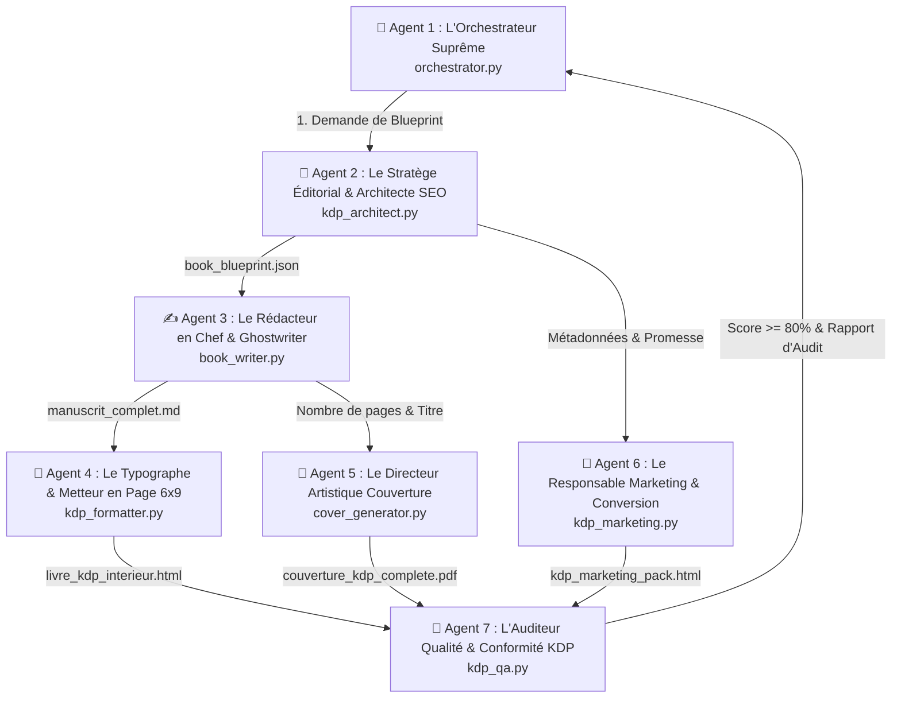

# 🏛️ SYSTÈME MULTI-AGENTS CHIRURGICAL — MACHINE DE CRÉATION AMAZON KDP

Ce document définit l'architecture organisationnelle, les rôles spécialisés, la hiérarchie de commandement, les contrats d'interface (I/O) et les portes de contrôle qualité (Quality Gates) de l'écosystème de production automatisée de livres professionnels Amazon KDP.

---

## 🌳 1. Arborescence & Cartographie Chirurgicale des Agents

```text
mon-espace-ia/
│
├── 👑 [ORCHESTRATOR]
│   └── orchestrator.py           # Chef d'orchestre suprême, gestionnaire d'état & reprise
│
├── 🧠 [STRATÉGIE & CONCEPTION]
│   └── kdp_architect.py          # Agent Architecte SEO & Planificateur éditorial (10x5 sections)
│
├── ✍️ [RÉDACTION ÉDITORIALE]
│   ├── book_writer.py            # Agent Rédacteur en Chef & Ghostwriter séquentiel
│   └── livre_sections/           # Registre des 50 sous-sections générées individuellement
│
├── 🎨 [DIRECTION ARTISTIQUE]
│   └── cover_generator.py        # Agent Designer Couverture complète 300 DPI (Plat 1 + Dos + Plat 4)
│
├── 📐 [TYPOGRAPHIE & MISE EN PAGE]
│   └── kdp_formatter.py          # Agent Typographe Intérieur 6x9 pouces avec marges de reliure
│
├── 🛒 [MARKETING & CONVERSION]
│   └── kdp_marketing.py          # Agent Copywriter Amazon (Description HTML, 7 mots-clés, A+ Content)
│
├── 🔬 [CONTRÔLE QUALITÉ & CERTIFICATION]
│   └── kdp_qa.py                 # Agent Auditeur Qualité & Conformité Amazon KDP
│
├── 🌐 [DISTRIBUTION & API INTERFACE]
│   └── server.py                 # Hub API FastAPI pour intégration n8n / Hermes / Webhooks
│
└── 🧪 [SUITE DE TESTS & VALIDATION]
    └── test_suite.py             # Banc d'essai automatisé de validation chirurgicale (14 tests)
```

---

## 👑 2. Hiérarchie & Matrice RACI des Agents



---

## 📋 3. Spécification Détaillée des 7 Rôles Chirurgicaux

---

### 👑 AGENT 1 : L'Orchestrateur Suprême
* **Fichier source :** [`orchestrator.py`](file:///c:/Users/acer/OneDrive/Desktop/mon-espace-ia/orchestrator.py)
* **Mission :** Piloter la chaîne de production de bout en bout, gérer les états de progression, assurer la résilience contre les pannes et exécuter les transitions entre agents.
* **Entrées :** `--niche` (thématique du livre), `--cible` (public visé), `--step` (optionnel pour exécution ciblée).
* **Sorties :** Déclenchement ordonné des agents, journalisation du temps d'exécution et rapport de synthèse final.
* **Porte Qualité (Gate 1) :** Bloque la chaîne si un agent prérequis échoue et permet une reprise sans perte de données.

---

### 🧠 AGENT 2 : Le Stratège Éditorial & Architecte SEO
* **Fichier source :** [`kdp_architect.py`](file:///c:/Users/acer/OneDrive/Desktop/mon-espace-ia/kdp_architect.py)
* **Mission :** Analyser le marché Amazon KDP, identifier la promesse de transformation et générer un plan chirurgical de **10 chapitres découpés en 5 sous-sections concrètes (50 parties au total)**.
* **Entrées :** Niche, public cible.
* **Sorties :** [`book_blueprint.json`](file:///c:/Users/acer/OneDrive/Desktop/mon-espace-ia/book_blueprint.json) contenant :
  * Titre percutant et sous-titre SEO
  * 7 mots-clés backend stratégiques
  * 2 catégories BISAC cibles
  * 10 chapitres avec objectifs pédagogiques et points clés par section.
* **Porte Qualité (Gate 2) :** Validation stricte du schéma JSON (exactement 10 chapitres, 5 sous-parties par chapitre, présence des 7 mots-clés).

---

### ✍️ AGENT 3 : Le Rédacteur en Chef & Ghostwriter Best-Seller
* **Fichier source :** [`book_writer.py`](file:///c:/Users/acer/OneDrive/Desktop/mon-espace-ia/book_writer.py)
* **Mission :** Rédiger séquentiellement chaque sous-partie avec une densité d'information maximale (700 à 900 mots par section), des exemples chiffrés, des études de cas, des encadrés d'action immédiate, et compiler le tout dans un manuscrit global.
* **Entrées :** `book_blueprint.json`
* **Sorties :** 
  * `livre_sections/chapitre_XX_section_YY.md` (checkpoints unitaires)
  * [`manuscrit_complet.md`](file:///c:/Users/acer/OneDrive/Desktop/mon-espace-ia/manuscrit_complet.md) (volume cible : 25 000 à 45 000 mots, soit ~150 à 180 pages d'édition).
* **Porte Qualité (Gate 3) :** Reprise automatique sur incident (si une section existe déjà sur disque, elle n'est pas réécrite pour préserver les quotas de l'API).

---

### 📐 AGENT 4 : Le Typographe & Ingénieur de Formatage Intérieur
* **Fichier source :** [`kdp_formatter.py`](file:///c:/Users/acer/OneDrive/Desktop/mon-espace-ia/kdp_formatter.py)
* **Mission :** Transformer le manuscrit brut en un livre de haute tenue typographique conforme aux exigences de l'impression papier Amazon KDP.
* **Spécifications d'impression :**
  * Format de coupe : **6" × 9"** (15,24 × 22,86 cm)
  * Marge de reliure (Gutter) : **0.85 pouce** (évite que le texte ne soit mangé par la couture du dos)
  * Marges extérieures : **0.55 pouce**
  * Folios et en-têtes alternés (pages paires à gauche, impaires à droite)
  * Sauts de page stricts (`page-break-before: always;`) avant chaque grand chapitre.
* **Sorties :** [`livre_kdp_interieur.html`](file:///c:/Users/acer/OneDrive/Desktop/mon-espace-ia/livre_kdp_interieur.html) (print-ready) et [`livre_kdp_interieur.pdf`](file:///c:/Users/acer/OneDrive/Desktop/mon-espace-ia/livre_kdp_interieur.pdf).

---

### 🎨 AGENT 5 : Le Directeur Artistique & Designer Couverture
* **Fichier source :** [`cover_generator.py`](file:///c:/Users/acer/OneDrive/Desktop/mon-espace-ia/cover_generator.py)
* **Mission :** Calculer dynamiquement l'épaisseur de la tranche du livre (dos) selon le nombre exact de pages, et générer le gabarit complet de couverture à **300 DPI** au format PDF.
* **Spécifications techniques :**
  * Épaisseur du papier blanc standard KDP : `0.002252 pouce / page`
  * Largeur du dos : `nb_pages × 0.002252 in`
  * Fond perdu (Bleed) : `0.125 pouce` sur tout le pourtour
  * Résolution : `300 DPI` (qualité d'impression industrielle)
  * Réservation normalisée pour le code-barres ISBN Amazon (zone blanche de `600 × 360 px` en 4ème de couverture).
* **Sorties :** [`couverture_kdp_complete.pdf`](file:///c:/Users/acer/OneDrive/Desktop/mon-espace-ia/couverture_kdp_complete.pdf).

---

### 🛒 AGENT 6 : Le Responsable Marketing & Conversion Amazon
* **Fichier source :** [`kdp_marketing.py`](file:///c:/Users/acer/OneDrive/Desktop/mon-espace-ia/kdp_marketing.py)
* **Mission :** Maximiser le taux de clics (CTR) et le taux de conversion de la page Amazon en fournissant une rédaction commerciale persuasive.
* **Actifs générés :**
  * Description de vente en HTML strict accepté par KDP (`<h2>`, `<b>`, `<ul>`, `<li>`)
  * Les 7 mots-clés backend optimisés pour le moteur de recherche A9 d'Amazon
  * 3 modules graphiques pour la section A+ Content ("Informations de l'éditeur").
* **Sorties :** [`kdp_marketing_pack.html`](file:///c:/Users/acer/OneDrive/Desktop/mon-espace-ia/kdp_marketing_pack.html).

---

### 🔬 AGENT 7 : L'Auditeur Qualité & Conformité KDP
* **Fichier source :** [`kdp_qa.py`](file:///c:/Users/acer/OneDrive/Desktop/mon-espace-ia/kdp_qa.py)
* **Mission :** Inspecter chirurgicalement chaque livrable avant publication.
* **Points de contrôle :**
  * Respect du gabarit 6x9 po et présence du gutter
  * Volume textuel et nombre de pages estimé
  * Présence de la couverture 300 DPI et du dos calculé
  * Absence de termes parasites ou d'erreurs de génération
  * Calcul d'un **Score de Conformité sur 100**.
* **Sorties :** Rapport d'audit dans la console et badge de validation KDP.

---

## ⚡ 4. Guide de Commande & Utilisation Rapide

| Objectif | Commande à exécuter | Agent mobilisé |
| :--- | :--- | :--- |
| **Pipeline complet de A à Z** | `python orchestrator.py --niche "Votre Niche" --cible "Votre Public"` | Tous les agents (1 à 7) |
| **Concevoir uniquement le plan** | `python orchestrator.py --step architect` | Agent 2 (kdp_architect) |
| **Lancer la rédaction complète** | `python orchestrator.py --step writer` | Agent 3 (book_writer) |
| **Mettre en page l'intérieur** | `python orchestrator.py --step formatter` | Agent 4 (kdp_formatter) |
| **Générer la couverture 300 DPI** | `python orchestrator.py --step cover` | Agent 5 (cover_generator) |
| **Créer la description Amazon** | `python orchestrator.py --step marketing` | Agent 6 (kdp_marketing) |
| **Auditer la conformité KDP** | `python orchestrator.py --step qa` | Agent 7 (kdp_qa) |
| **Banc de tests unitaires (14 tests)** | `python test_suite.py` | Suite d'intégration globale |

---

## 🌐 5. Intégration n8n / Hermes / Serveur FastAPI

Le fichier [`server.py`](file:///c:/Users/acer/OneDrive/Desktop/mon-espace-ia/server.py) expose l'infrastructure via API REST :
* `POST /kdp/blueprint` : Déclenche l'Agent Architecte
* `POST /kdp/format` : Déclenche l'Agent Typographe
* `POST /generate` : Moteur de génération textuelle rapide
* Documentation OpenAPI interactive : [http://127.0.0.1:8000/docs](http://127.0.0.1:8000/docs)

---

## 🧩 6. Package d'Extension `kdp_extensions/` (Sur-Ensemble Zéro-Casse)

Ce package est un **sur-ensemble** : aucun fichier existant à la racine n'est déplacé,
renommé ni supprimé, et aucune signature ni comportement par défaut n'est modifié.
Toute nouvelle fonctionnalité y est ajoutée uniquement.

```text
kdp_extensions/
├── __init__.py              # Package d'extension (kdp_dimensions, media_connectors, coloring_book_engine)
├── kdp_dimensions.py        # Référentiel des 16 formats KDP officiels + calculate_kdp_specs()
├── media_connectors.py      # Connecteurs Unsplash, Pixabay & Canva Connect API (httpx + Pillow)
└── coloring_book_engine.py  # Moteur de livres de coloriage 16 formats (SVG, Playwright, couverture)
```

### 6.1. Référentiel des 16 Formats KDP — [`kdp_dimensions.py`](file:///c:/Users/acer/OneDrive/Desktop/mon-espace-ia/kdp_extensions/kdp_dimensions.py)

Formats officiels supportés : `5x8`, `5.06x7.81`, `5.25x8`, `5.5x8.5`, `6x9`,
`6.14x9.21`, `6.69x9.61`, `7x10`, `7.44x9.69`, `7.5x9.25`, `8.25x6`, `8.25x8.25`,
`8.5x8.5`, `8x10`, `8.5x11`, `8.27x11.69`.

* `calculate_kdp_specs(trim_id, page_count, paper_type="white", bleed=True)` calcule :
  * les **marges dynamiques KDP** (gutter 0.375" ≤150 p. → 0.75" >400 p., bleed 0.125" ajouté aux marges de sécurité) ;
  * l'**épaisseur de dos** : `white` 0.002252 · `cream` 0.0025 · `color_standard` 0.002349 · `color_premium` 0.0025 pouces/page ;
  * les **dimensions 300 DPI** de l'intérieur et de la couverture complète (Plat 4 + Dos + Plat 1 + 2 × bleed) ;
  * la **réserve ISBN : 600 × 360 px**.

### 6.2. Connecteurs Média — [`media_connectors.py`](file:///c:/Users/acer/OneDrive/Desktop/mon-espace-ia/kdp_extensions/media_connectors.py)

* `search_stock_images(query, source="all", orientation="portrait", per_page=12)`
  * **Unsplash** : `UNSPLASH_ACCESS_KEY`, en-tête `Authorization: Client-ID ...`
  * **Pixabay** : `PIXABAY_API_KEY` sur `https://pixabay.com/api/` (`orientation='vertical'` pour portrait, `image_type='photo'|'vector'`, URL HD = `hit.get("fullHDURL") or hit.get("largeImageURL")`, aperçu = `hit.get("webformatURL")`)
  * Repli sur un catalogue curé hors-ligne si une clé manque (jamais de liste vide)
* `download_and_prepare_cover_bg(image_url, target_width_px, target_height_px)` : téléchargement **systématique** dans `assets/media_cache/` (conformité anti-hotlinking), recadrage sans déformation (`ImageOps.fit`), sauvegarde JPEG **300 DPI**
* **Canva Connect API** : `get_canva_auth_url()` (OAuth 2.0 + state CSRF) → `exchange_canva_code_for_token()` (callback → `canva_tokens.json`) → `upload_canva_asset()` → `export_canva_design()` avec **fallback** générant un gabarit PNG/PDF 300 DPI (dos calculé, ISBN 600 × 360 px) prêt à ouvrir dans Canva

### 6.3. Moteur de Coloriage — [`coloring_book_engine.py`](file:///c:/Users/acer/OneDrive/Desktop/mon-espace-ia/kdp_extensions/coloring_book_engine.py)

* Formats : `8.5" × 11"` par défaut ou **l'un des 16 formats KDP**
* Planches **noir pur** `#000000` sur `#FFFFFF`, **zéro niveau de gris** (SVG vectoriel haute précision ou conversion line-art Pillow binaire)
* Option **recto uniquement** : page verso blanche anti-bavure après chaque illustration
* Compilation **PDF 300 DPI via Playwright** (repli automatique `msedge`)
* Couverture **calibrée via [`cover_artisan_agent.py`](file:///c:/Users/acer/OneDrive/Desktop/mon-espace-ia/cover_artisan_agent.py)** (tranche au micron, fond photo injectable)

---

## 🤖 7. Subagents OpenCode & Skill Dédié

```text
.opencode/
├── agents/
│   ├── kdp-media-designer.md      # @kdp-media-designer — Images 300 DPI, galerie Unsplash/Pixabay, Canva
│   └── kdp-coloring-artisan.md    # @kdp-coloring-artisan — Livres de coloriage 16 formats, PDF Playwright
└── skills/
    └── kdp-visual-pipeline/
        └── SKILL.md               # Skill « Pipeline Visuel KDP » (orchestration complète)
```

| Routage de la demande | Subagent mobilisé |
| :--- | :--- |
| Recherche d'image, visuel de couverture, galerie stock, export Canva | `@kdp-media-designer` |
| Livre de coloriage, planche noir & blanc, verso anti-bavure, PDF Playwright | `@kdp-coloring-artisan` |

Le skill **`kdp-visual-pipeline`** documente l'ensemble du pipeline : 16 formats,
connecteurs média, moteur de coloriage, routes HTTP et contrôle qualité.

### Routes API d'extension (`app_studio.py`)

| Route | Rôle |
| :--- | :--- |
| `GET /api/kdp/formats` | Liste des 16 formats KDP officiels |
| `GET /api/media/search` | Galerie **Unsplash + Pixabay** |
| `GET /api/canva/auth-url` | URL d'autorisation OAuth 2.0 Canva |
| `GET /api/canva/callback` | Échange du code → `canva_tokens.json` |
| `GET /api/canva/template/{book_id}` | Gabarit PNG 300 DPI |
| `GET /api/canva/export/{book_id}` | Export design (live) ou gabarit local (fallback) |

Champs **optionnels** ajoutés à `POST /api/books/create` (valeurs par défaut,
compatibilité totale) : `project_type` (`non_fiction` | `coloring_book`),
`cover_image_url`, `single_sided`.

---

## 🧪 8. Exécution Obligatoire & Validation

Sur **Windows 11**, toute exécution passe par le virtualenv du projet :

```powershell
.\.venv\Scripts\python.exe -m pytest test_suite.py test_extensions.py
```

* `test_suite.py` : suite historique — **24/24 sans aucune modification** (non-régression).
* `test_extensions.py` : validations des extensions (16 formats, specs 300 DPI,
  connecteurs HTTP **mockés** Unsplash/Pixabay, Canva **mocké**, moteur de coloriage **mocké**).
