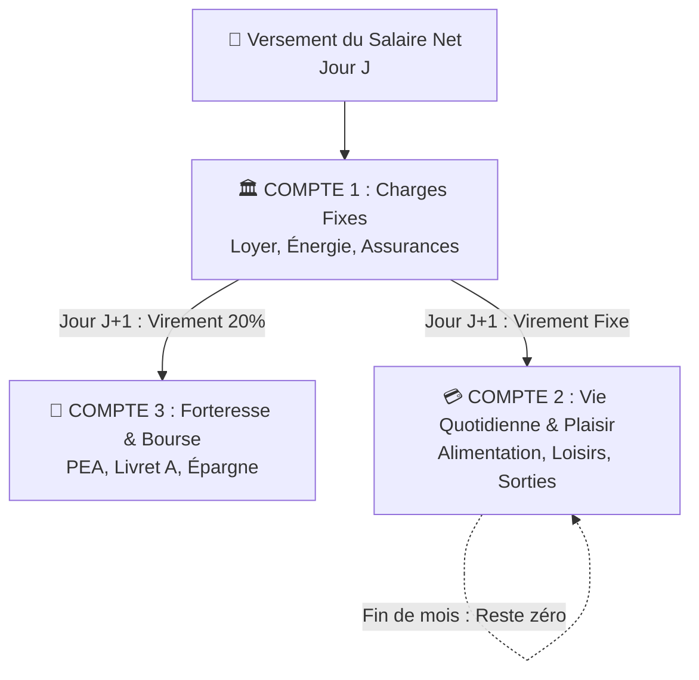

### 4.2 L'architecture des 3 comptes bancaires étanches

Gérer l'ensemble de ses finances sur un compte bancaire unique avec une carte de débit sans contact est la méthode la plus sûre pour perdre le contrôle de ses flux. Lorsque vos charges fixes, vos sorties au restaurant et vos projets d'investissement cohabitent sur le même solde, la porosité psychologique est totale : vous voyez un solde positif de 1 200 € le 15 du mois et vous croyez faussement avoir les moyens d'engager une dépense plaisir imprévue.

Pour éliminer ce biais, vous devez mettre en place **l'Architecture des 3 Comptes Étanches** :

1. **Compte 1 : Le Compte Courant Fixe (La Salle des Machines) :**
   * *Rôle :* Réception du salaire et paiement exclusif des charges incompressibles (loyer, électricité, assurances, impôts).
   * *Règle :* Aucune carte de paiement physique pour les sorties n'est associée à ce compte.
2. **Compte 2 : Le Compte Dépenses Plaisir (Le Compte Carte) :**
   * *Rôle :* Alimenté par un virement mensuel fixe le 1er du mois pour les courses alimentaires du quotidien, les sorties, le shopping et les loisirs.
   * *Règle :* Carte bancaire à débit immédiat sans découvert autorisé. Si le solde atteint 0 €, les sorties payantes s'arrêtent jusqu'au 1er du mois suivant.
3. **Compte 3 : Le Hub d'Investissement & Sécurité (La Forteresse) :**
   * *Rôle :* Réception du prélèvement d'épargne automatique et dispatching vers les livrets d'urgence et enveloppes fiscales (PEA, Assurance-Vie).
   * *Règle :* Aucun moyen de paiement immédiat associé pour interdire tout achat impulsif.

#### Schéma des Flux Bancaires Mensuels

#### Le Piège Fréquent & La Parade

> ❌ **Le piège fatal :** Payer des frais de gestion exorbitants en ouvrant plusieurs comptes dans des banques traditionnelles physiques.  
>  
> ✅ **La contre-mesure :** Utilisez les banques en ligne ou néobanques modernes sans frais de tenue de compte pour vos comptes secondaires (BoursoBank, Fortuneo, Revolut).

---

> ⚡ **Action Immédiate (Moins de 24 Heures) :**
>
> 1. Ouvrez un compte bancaire secondaire gratuit en ligne avec carte de débit sans découvert autorisé.
> 2. Calculez votre budget mensuel exact de dépenses quotidiennes (courses + loisirs).
> 3. Préparez le paramétrage du virement automatique mensuel du Compte 1 vers ce Compte 2.
